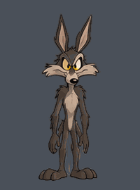

# Койот 360° — вращаемый 2D-персонаж

Интерактивный поворот рисованного койота на 360°: тянете мышью или пальцем,
включаете авто-вращение, останавливаете на любом ракурсе.



## Запуск

Сборка не нужна, все кадры уже лежат в `web/assets/`.

- **Проще всего:** откройте `web/index.html` в браузере двойным кликом
  (данные кадров подключены скриптом `assets/manifest.js`, поэтому страница работает и с `file://`).
- **Через локальный сервер** (нужен, чтобы открыть с телефона в той же Wi‑Fi сети):
  ```bash
  cd web
  python3 -m http.server 8000
  # компьютер: http://localhost:8000
  # телефон:   http://<IP-компьютера>:8000
  ```

### Управление

| Действие | Как |
|---|---|
| Вращать | тянуть по сцене мышью / пальцем (бросок даёт инерцию) |
| Авто-вращение | кнопка «▶ Авто» или пробел; ⟳/⟲ меняет направление, ползунок — скорость |
| Остановить на ракурсе | «❚❚ Стоп», любое касание сцены или ползунок угла |
| Шаг по кадрам | ← / → |
| Набор кадров | 36 кадров с шагом 10° или 72 кадра с шагом 5° (половина — интерполяция) |
| Сглаживание | смешивание соседних кадров при промежуточных углах (по умолчанию выключено) |
| Доводка к ракурсу | после отпускания поворот плавно встаёт на ближайший настоящий кадр |

Кадры, которых нет в исходном рисунке, помечены в углу сцены: оранжевый значок
«интерполированный кадр» или зелёный «дорисованный кадр». Под сценой написано,
откуда взят текущий кадр.

## Почему Canvas + спрайт-лист

- Персонаж нарисован растром (мех, мягкая заливка), поэтому SVG-векторизация
  исказила бы стиль, а скелетная анимация не даёт настоящего поворота в глубину.
- Один PNG-спрайт = один запрос, все ракурсы мгновенно доступны; смена кадра —
  это просто `drawImage` из другого прямоугольника, без мерцания при подгрузке.
- Canvas даёт смешивание соседних кадров, постоянную тень на полу и чёткость на
  экранах с высокой плотностью пикселей. Отдельные PNG тоже сохраняются
  (`web/assets/frames/`) для монтажа или игрового движка.

## Структура

```
source/turnaround_sheet.png   исходный лист 9×4
tools/common.py               сетка листа и вырезание персонажа из фона
tools/build_frames.py         выравнивание, сборка цикла 360°, проверка соседних кадров
tools/redraw.py               дорисовка 120–180°: перенос кадров, поворот хвоста, вид сзади
tools/morph.py                межкадровая интерполяция оптическим потоком (OpenCV)
tools/interpolate.py          набор с шагом 5° (72 кадра)
tools/make_preview.py         превью-GIF и QA-лист
web/index.html, viewer.js, style.css   просмотрщик
web/assets/coyote_sprite.png           36 кадров (6×6, 200×270 px каждый)
web/assets/coyote_sprite_5deg.png      72 кадра
web/assets/manifest*.json / .js        углы, источник каждого кадра, метрики
docs/qa_contact_sheet.png              все кадры + оценка перехода к следующему
```

Пересборка кадров (Python 3, `pip install numpy pillow opencv-python-headless`):

```bash
python3 tools/build_frames.py   # 36 кадров + проверка, ~1 мин
python3 tools/interpolate.py    # 72 кадра
python3 tools/make_preview.py   # docs/
```

## Что было сделано с исходным листом

Анализ показал, что лист **нельзя просто проиграть подряд**:

1. **Нет 80°**: в первом ряду после 70° сразу идёт 90°, а 360° повторяет 0°.
2. **Вторая половина повёрнута не в ту сторону**: в ячейках 240–340° морда
   смотрит вправо, как в 40–90°. При честном повороте после вида сзади (180°)
   морда должна смотреть влево. Если проиграть лист как есть, будут скачки
   230°→240° (спина → правый профиль) и 340°→350° (профиль → анфас).
3. **Разные масштаб и положение**: ячейки разной ширины (161–186 px), персонаж
   стоит на разной высоте (линия ступней отличается на ~10 px между рядами),
   350° нарисован заметно меньше, чем 0°.
4. **Повторы**: 100–170° почти одинаковые профили, 180–230° почти одинаковые виды
   со спины.
5. Метка угла и нарисованная тень под ногами меняются от ячейки к ячейке.

Исправления в `tools/build_frames.py`:

- персонаж вырезан из фона (метка и тень убраны, тень рисуется просмотрщиком,
  одинаковая для всех кадров);
- **масштаб** подобран для каждого кадра по совпадению силуэта нижней части тела
  с предыдущим кадром (голова и уши при повороте меняются, ноги и туловище — нет);
- **все кадры стоят на одной линии ступней**; ось вращения для анфаса и спины —
  ось симметрии силуэта, для остальных — середина ступней с поправкой;
- **0–110° взяты из листа, 120–180° дорисованы (см. ниже), 190–350° — зеркальные копии 170–10°**. Для симметричного
  персонажа это геометрически правильно и гарантирует, что обе половины
  поворота совпадают по масштабу и пропорциям;
- **80° синтезирован** оптическим потоком между 70° и 90° (280° — его зеркало).
  Оба кадра помечены как интерполированные.

## Дорисовка 120–180° (`tools/redraw.py`)

В листе нет настоящего вида сзади. Ячейка «180°» на самом деле изображает
три четверти со спины: стопы смотрят вправо, видна одна щека, хвост висит
сбоку. Голова в 100–170° почти не отворачивается. Поэтому эта четверть
собрана заново **из частей рисунков самого листа**. Это не рисунок с нуля:
части сдвинуты, отзеркалены и перекрашены.

| Угол | Откуда |
|---|---|
| 120° | лист, 120° |
| 130° | лист, 140° (130° почти дублировал соседей) |
| 140° | лист, 160° |
| 150° | лист, 170° |
| 160° | ячейка «180°»: голова уже отвёрнута, хвост на 30 % пути к центру |
| 170° | тело вида сзади, слегка сужено; голова из ячейки «180°» (ещё чуть повёрнута); хвост на 70 % пути |
| 180° | **настоящий вид сзади**: силуэт анфаса, где светлая грудь перекрашена в мех спины, синеватые тени — в тёмный мех, а пальцы на стопах затёрты; затылок с ушами из ячейки «180°», отзеркаленный до симметрии; хвост висит по центру |

Хвост вырезан из ячейки «180°» и плавно поворачивается вокруг основания:
от положения сбоку до положения по центру между ногами. Центр корпуса в
130–170° проходит по плавной траектории к оси вида сзади. Поскольку 180°
симметричен, а хвост висит по центру, 190° (зеркало 170°) продолжает поворот
без перескока хвоста.

## Проверка плавности: честный итог

Для каждой пары соседних кадров считается совпадение силуэтов (IoU) и разница
цвета. Результат лежит в `manifest.json`, наглядно — в `docs/qa_contact_sheet.png`.

| Переход | до дорисовки | после |
|---|---|---|
| 150° → 160° | 0.81 | 0.62 |
| 160° → 170° | 0.82 | 0.69 |
| 170° → 180° | **0.54** | 0.84 |
| 180° → 190° | **0.36** | 0.78 |

Раньше переход 150→170° шёл почти без изменений (одни и те же профили), а
весь разворот спиной случался рывком на 170→190°. Теперь он распределён на
четыре шага по 10°.

Что осталось:

- **150° → 160°** всё ещё заметнее остальных шагов (IoU 0.62, помечен как «скачок»).
  Здесь голова уходит из профиля за щёку, и промежуточного рисунка головы нет.
- **350° → 0°** (IoU 0.62): на 10° у персонажа уже повёрнута голова, а на 0° он строго анфас.
- **Где видны следы сборки.** Затылок на 180° чуть мягче остального рисунка:
  центральные штрихи затёрты. По контуру стоп остались бугорки пальцев.
  У 170° туловище от вида сзади, а голова от ячейки «180°», поэтому уши чуть
  смещаются между 170° и 180°.
- Кадры с шагом 5° — это **неподтверждённая интерполяция**. Для 155°, 205° и 355°
  уверенность низкая.
- Разрешение ограничено исходником: персонаж высотой примерно 240 px.

### Что ещё улучшит поворот

1. Нарисовать вручную голову на 150–160°: морда наполовину скрыта щекой, видно
   одно ухо целиком, а второе частично. Это уберёт последний заметный шаг.
2. Нарисовать стопы сзади (пятки) для 170–180°.
3. Положить исправленные кадры в лист с той же сеткой или поменять части в
   `tools/redraw.py` и запустить `tools/build_frames.py`. Выравнивание и
   проверка повторятся автоматически.
